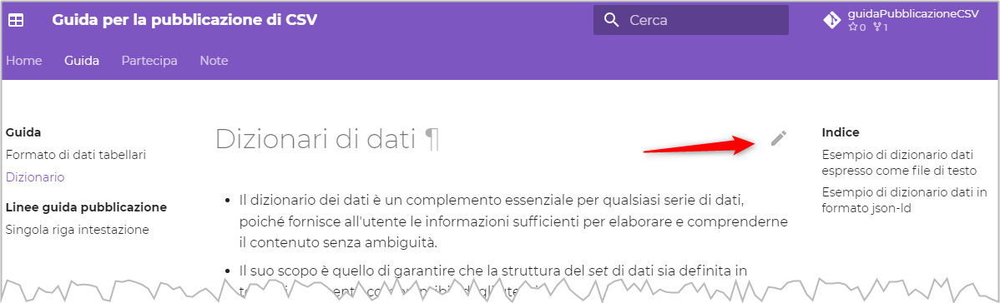

<!-- ALL-CONTRIBUTORS-BADGE:START - Do not remove or modify this section -->
[](#contributors-)
<!-- ALL-CONTRIBUTORS-BADGE:END -->

# Guida pratica per la pubblicazione di dati tabellari in formato CSV

Questo progetto nasce per creare una **guida** per la **pubblicazione** sul web di **dati** in **formato** **`CSV`** (*Comma Separated Values*). È un formato di testo strutturato, con una riga di intestazione, in cui i valori di ogni colonna sono distinti con un separatore che di solito è la `,`.

Ad esempio:

```
nome_comune,abitanti,cod_istat
Palermo,636783,082053
None,8028,001168
Cella Dati,506,019028
```

È uno dei **formati** **più** **diffusi** per la **pubblicazione** di **dati** testuali, sicuramente **il più diffuso** nei **portali *open data***.<br>È principalmente utilizzato per intermediare l'accesso ai dati, per non avere barriere tecnologiche, ma non come formato di "lavoro": non è possibile definire il tipo di campo (se un campo è numerico o testuale), se è obbligatorio esprimere un valore per i dati di una colonna, non dispone di indici, ecc..

💡 Vista la loro diffusione abbiamo creato una **guida** per la **"buona" pubblicazione** di **questi file**.

Questa guida è ispirata fortissimamente (ne è in parte la traduzione) dalla [**splendida guida del "Ministry of Economic Affairs and Digital Transformation” di Spagna**](https://datos.gob.es/en/documentacion/guia-practica-para-la-publicacion-de-datos-tabulares-en-archivos-csv) (a loro un grazie!), ma non ne è una perfetta copia, ci sono nuove sezioni e alcuni contenuti sono stati modificati o aggiornati.


## Partecipa

Questa **guida** è un **bene comune**, sia per il **lettore** che per l'**autore**.

Da **lettore**, sei **libero** di:

- **Condividere** — riprodurre, distribuire, comunicare al pubblico, esporre in pubblico, rappresentare, eseguire e recitare questo materiale con qualsiasi mezzo e formato
- **Modificare** — remixare, trasformare il materiale e basarti su di esso per le tue opere
per qualsiasi fine, anche commerciale.

Alle seguenti condizioni:

- **Attribuzione** — Devi riconoscere una menzione di paternità adeguata, fornire un link alla licenza e indicare se sono state effettuate delle modifiche. Puoi fare ciò in qualsiasi maniera ragionevole possibile, ma non con modalità tali da suggerire che il licenziante avalli te o il tuo utilizzo del materiale.
- **Divieto di restrizioni aggiuntive** — Non puoi applicare termini legali o misure tecnologiche che impongano ad altri soggetti dei vincoli giuridici su quanto la licenza consente loro di fare.


Da **autore** puoi:

- se **non sai usare git e GitHub**: [**aprire una nuova discussione qui**](https://github.com/ondata/guidaPraticaPubblicazioneCSV/discussions), con delle proposte, suggerimenti, domande o per mostrarci per cosa ti è stata utile questa guida;
- se **sai usare git e GitHub**:
    - clonare il *repository* e fare delle *Pull Request*;
    - proporre delle modifiche al testo e suggerire delle correzioni, utilizzando il tasto <kbd>EDIT</kbd>, che trovi in ogni pagina, in alto a destra (vedi immagine sotto) e fare sempre delle *Pull Request*, ma più "visuali", direttamente dall'interfaccia web.

[](https://ondata.github.io/guidaPraticaPubblicazioneCSV/guida/)

➡ [Leggi la guida](https://ondata.github.io/guidaPraticaPubblicazioneCSV/guida/)

## Contributors ✨

Thanks goes to these wonderful people ([emoji key](https://allcontributors.org/docs/en/emoji-key)):

<!-- ALL-CONTRIBUTORS-LIST:START - Do not remove or modify this section -->
<!-- prettier-ignore-start -->
<!-- markdownlint-disable -->
<table>
  <tr>
    <td align="center"><a href="http://cirospat.readthedocs.io"><br /><sub><b>ciro spataro</b></sub></a><br /><a href="#content-cirospat" title="Content">🖋</a> <a href="#example-cirospat" title="Examples">💡</a></td>
    <td align="center"><a href="http://pigrecoinfinito.com"><br /><sub><b>Salvatore Fiandaca</b></sub></a><br /><a href="#content-pigreco" title="Content">🖋</a> <a href="#example-pigreco" title="Examples">💡</a></td>
    <td align="center"><a href="https://github.com/patrunomeister"><br /><sub><b>Vincenzo Patruno</b></sub></a><br /><a href="#content-patrunomeister" title="Content">🖋</a> <a href="#example-patrunomeister" title="Examples">💡</a></td>
    <td align="center"><a href="https://coseerobe.gbvitrano.it/"><br /><sub><b>Giovan Battista Vitrano</b></sub></a><br /><a href="#content-gbvitrano" title="Content">🖋</a> <a href="#example-gbvitrano" title="Examples">💡</a></td>
    <td align="center"><a href="https://github.com/lorenzoperone"><br /><sub><b>lorenzo perone</b></sub></a><br /><a href="#content-lorenzoperone" title="Content">🖋</a> <a href="#example-lorenzoperone" title="Examples">💡</a></td>
    <td align="center"><a href="https://github.com/dennisangemi"><br /><sub><b>Dennis Angemi</b></sub></a><br /><a href="#content-dennisangemi" title="Content">🖋</a></td>
  </tr>
</table>

<!-- markdownlint-restore -->
<!-- prettier-ignore-end -->

<!-- ALL-CONTRIBUTORS-LIST:END -->

This project follows the [all-contributors](https://github.com/all-contributors/all-contributors) specification. Contributions of any kind welcome!
