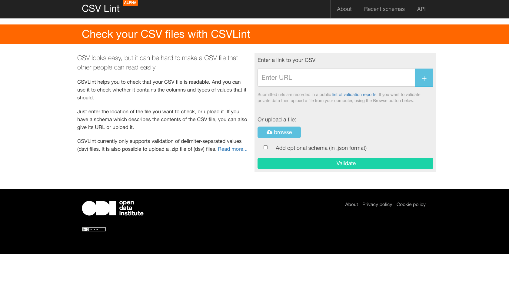
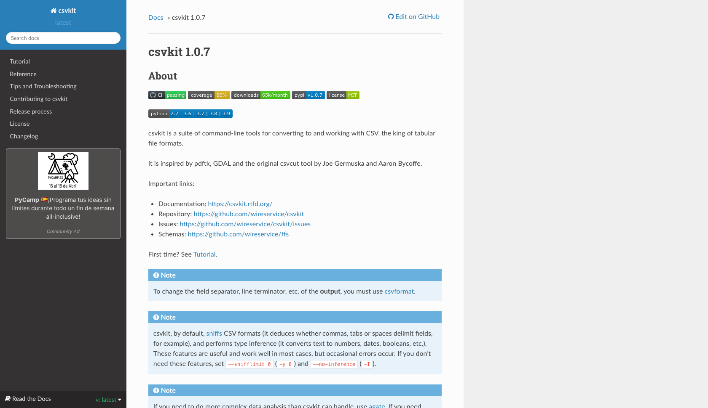

---
hide:
 - toc
# - navigation
title: Cassetta degli attrezzi per i file CSV
---

Ci sono **strumenti** disponibili per l'**elaborazione di file `CSV`** che forniscono una serie di **diverse funzionalità**, si tratta di **strumenti gratuiti** che di solito sono offerti come servizio, cioè sono disponibili online o richiedono l'installazione di software sul proprio computer. Sono in grado di **convalidare le strutture dei dati**, cioè la coerenza tra il numero di campi di intestazione e il numero di campi in ogni riga di dati, così come la **coerenza dei tipi e dei valori dei dati** in ogni cella. Si distinguono tra loro per la facilità d'uso e per specifiche funzionalità, sotto alcuni esempi.

| | Servizio/Suite di strumenti | Convalida della struttura | Pulizia dei dati | Conversione del formato |
| --- | --- | --- | --- | --- |
| **[CSV Lint](https://csvlint.io/)** | Online | :material-check-bold:{ .spunta_verde } | :x: | :x: |
| **[Frictionless Framework](https://framework.frictionlessdata.io/)** | Riga di comando e libreria Python | :material-check-bold:{ .spunta_verde } | :x: | :x: |
| **[CSV kit](https://csvkit.readthedocs.io/en/latest/)** | Riga di comando | :material-check-bold:{ .spunta_verde } | :material-check-bold:{ .spunta_verde } | :material-check-bold:{ .spunta_verde } |

## Strumento: CSV Lint

**CSV Lint** è uno **strumento online** gestito dall'**Open Data Institute** realizzato per **verificare che un file `CSV` sia leggibile e ben formato**. Permette di **convalidare file `CSV` e schemi di tabelle di dati**, l'analisi viene eseguita su file caricati direttamente su CSV Lint o disponibili online: il file finisce quindi su un servizio esterno.
L'analisi **restituisce informazioni sugli errori** invalidanti per l'utilizzo dei dati, degli avvertimenti per elementi la cui correzione aiuta gli utenti dei dati e **messaggi informativi** con consigli per facilitarne l'utilizzo.

CSV Lint segnala come errore «Whitespace» il BOM che Excel aggiunge salvando in «CSV UTF-8»: non è un problema dei dati.

<figure markdown>
  
  <figcaption>CSV Lint</figcaption>
</figure>

## Strumento: Frictionless Framework

**Frictionless Framework** è lo strumento a riga di comando e la libreria Python del progetto Frictionless Data, che ha preso il posto di Goodtables, chiuso nel dicembre 2022. Controlla la struttura del file e, se gli si dà uno schema in formato [Table Schema](https://datapackage.org/standard/table-schema/), anche tipi e vincoli di ogni colonna. Table Schema è indicato, a titolo di esempio, dalle [Linee guida AgID](https://ondata.github.io/linee-guida-opendata/capitolo-5.html#sec-modellazione-e-documentazione).

```
uv tool install frictionless
frictionless validate dati.csv --encoding utf-8 --schema schema.yaml
```

Gli errori sono indicati con riga e colonna. Senza schema il controllo riguarda solo la struttura, quindi non si accorge, per esempio, di un CAP di tre cifre. Senza `--encoding utf-8`, un file che non è in UTF-8 può risultare valido.

## Strumento: CSV kit

[**CSV kit**](https://csvkit.readthedocs.io/en/latest/) è un **insieme di strumenti a riga di comando** per **convertire e lavorare con i file `CSV`**. **Permette di convertire file creati con Excel o file `JSON` in `CSV` e viceversa**, di eseguire diverse **operazioni a livello di colonna, riga o cella** e di **generare sintesi statistiche ed eseguire query `SQL` sui dati**.

```
uv tool install csvkit
csvclean --length-mismatch dati.csv
```

Il comando elenca le righe con un numero di campi diverso dall'intestazione. Attenzione: `csvlook` e `csvstat` deducono i tipi delle colonne, e un codice come `001272` può diventare `1,272`. Per i codici si usa l'opzione `-I` di `csvlook`.

<figure markdown>
  
  <figcaption>CSV kit</figcaption>
</figure>
