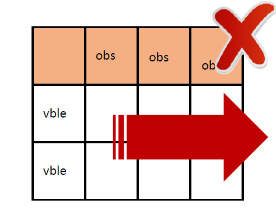
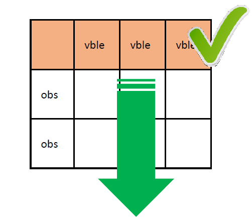

---
hide:
 - toc
# - navigation
title: Strutture dati verticale vs orizzontale
---

# Strutture dati: verticale vs orizzontale
Quando si progettano strutture di dati tabulari è consigliabile evitare la crescita orizzontale dei valori.

!!! failure "Modalità sconsigliata"

    ||osservazione|osservazione|osservazione|
    |---|---|---|---|
    |variabile||||
    |variabile||||

!!! success "Modalità consigliata"

    ||variabile|variabile|variabile|
    |---|---|---|---|
    |osservazione||||
    |osservazione||||

<!-- 
 -->

Quando è possibile, è preferibile mettere le variabili o gli attributi dei dati nelle colonne di una tabella e aggiungere i valori corrispondenti alle osservazioni dei dati nelle righe.

La crescita orizzontale di una struttura di dati tabulari può rendere difficile la manutenzione e la creazione di visualizzazioni.

In generale, è più facile identificare le relazioni tra le variabili nelle colonne che tra le righe, ed è più facile fare confronti tra gruppi di osservazioni nelle righe che tra gruppi di colonne.

Tuttavia, questa raccomandazione dovrebbe essere adattata in base alle esigenze di aggiornamento dei dati:

- Se è necessario registrare nuove variabili o attributi che non sono stati registrati in precedenza, per esempio un'informazione mai raccolta prima, allora è ragionevole far crescere la struttura dei dati orizzontalmente, cioè aggiungere nuove colonne. Questo permetterà di inserire le osservazioni per le nuove variabili mantenendo i valori vuoti nelle osservazioni pre-aggiornamento per queste nuove colonne, se non esiste un valore assegnabile per quelle osservazioni. Quando si aggiungono nuove osservazioni, si devono necessariamente inserire nuove righe.

### Esempio:
crescita orizzontale vs. verticale.

!!! failure "Cattiva prassi"

    |marca|guasto_radiatore|guasto_carburatore|guasto_sospensione|guasto_frizione|
    |-------|-------------------|---------------------|-------------------------|-------------------------|
    |chevrolet chevelle malibu|0|7|1|0|
    |buick skylark 320|1|2|2|2|
    |plymouth satellite|0|4|4|1|

!!! success "Buona prassi"

    |marca|tipo_guasto|quantita_guasti|
    |-------|-----------|---------------------|
    |chevrolet chevelle malibu|radiatore|0|
    |chevrolet chevelle malibu|carburatore|7|
    |chevrolet chevelle malibu|sospensione|1|
    |chevrolet chevelle malibu|frizione|0|
    |buick skylark 320|radiatore|1|
    |buick skylark 320|carburatore|2|
    |buick skylark 320|sospensione|2|
    |buick skylark 320|frizione|2|
    |plymouth satellite|radiatore|0|
    |plymouth satellite|carburatore|4|
    |plymouth satellite|sospensione|4|
    |plymouth satellite|frizione|1|

L'esempio mostra un modo di organizzare i dati evitando la crescita orizzontale della struttura dei dati aggiungendo nuove variabili simili a quelle esistenti. La trasposizione in una struttura verticale creando due nuove variabili, '`tipo_guasto`' e '`quantita_guasti`', permette di aggiungere facilmente nuove osservazioni sotto forma di righe.

### Serie temporali

Una serie temporale cresce per righe, non per colonne: `anno` è una variabile. La forma larga si può offrire come file aggiuntivo di consultazione, accanto a quella lunga.

!!! failure "Cattiva prassi"

    |marca|1972|1973|1974|
    |-------|----|----|----|
    |chevrolet chevelle malibu|345|423|1234|
    |buick skylark 320|124|252|785|

!!! success "Buona prassi"

    |marca|anno|domanda|
    |-------|----|-------|
    |chevrolet chevelle malibu|1972|345|
    |chevrolet chevelle malibu|1973|423|
    |chevrolet chevelle malibu|1974|1234|
    |buick skylark 320|1972|124|
    |buick skylark 320|1973|252|
    |buick skylark 320|1974|785|

