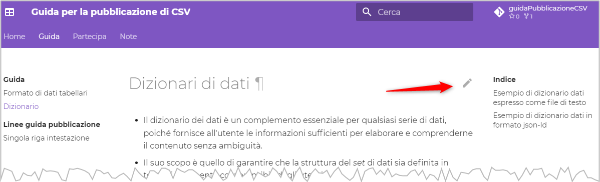

---
hide:
 - toc
 - navigation
title: Partecipa
---

# Partecipa

## Segnala o proponi

Hai trovato un errore o un esempio migliore? [Apri una discussione](https://github.com/ondata/guidaPraticaPubblicazioneCSV/discussions): bastano poche righe, e serve un account GitHub. Puoi usarla anche per fare una domanda, o per raccontare a cosa ti è servita la guida. Cerchiamo soprattutto esempi veri di CSV pubblicati da enti italiani.

Se usi git e GitHub puoi proporre la modifica direttamente, in due modi:

- clonare il repository e aprire una pull request;
- usare il tasto <kbd>EDIT</kbd> che trovi in alto a destra in ogni pagina (vedi immagine sotto), che apre il testo nell'interfaccia web di GitHub e crea la pull request da lì.

Il testo della guida è nella cartella [`docs`](https://github.com/ondata/guidaPraticaPubblicazioneCSV/tree/main/docs) del [repository](https://github.com/ondata/guidaPraticaPubblicazioneCSV/). Prima di proporre una modifica, leggi le [note per chi scrive](note_redazione.md).

## Riusa

Puoi copiare, modificare e riusare questa guida con qualsiasi mezzo, anche per fini commerciali, citando la fonte ([CC BY 4.0](https://creativecommons.org/licenses/by/4.0/deed.it)). Le condizioni sono due:

- **Attribuzione.** Devi indicare chi ha scritto il materiale, dare un link alla licenza e dire se lo hai modificato, senza lasciar intendere che chi lo ha scritto approvi te o il tuo uso.
- **Nessuna restrizione aggiuntiva.** Non puoi imporre ad altri, con termini legali o misure tecnologiche, vincoli su ciò che la licenza consente.

Il testo originale è soggetto alle [condizioni di riuso di datos.gob.es](https://datos.gob.es/es/aviso-legal).

## Citare questa guida

Per citare questa guida puoi usare questa riga:

onData (2026). *Guida pratica alla pubblicazione di dati in CSV*, versione 1.0.1. <https://doi.org/10.5281/zenodo.24051007>. Licenza CC BY 4.0.

Per citare sempre l'ultima versione, usa il DOI <https://doi.org/10.5281/zenodo.24042987>.
